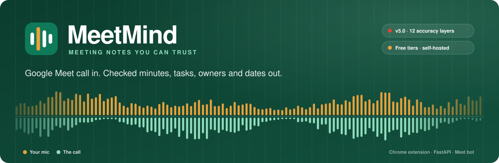
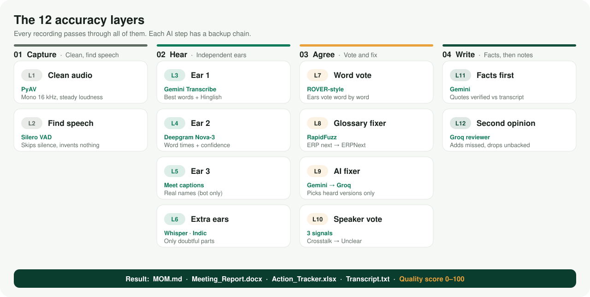
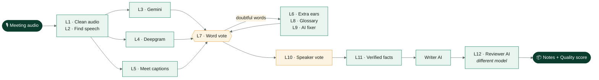
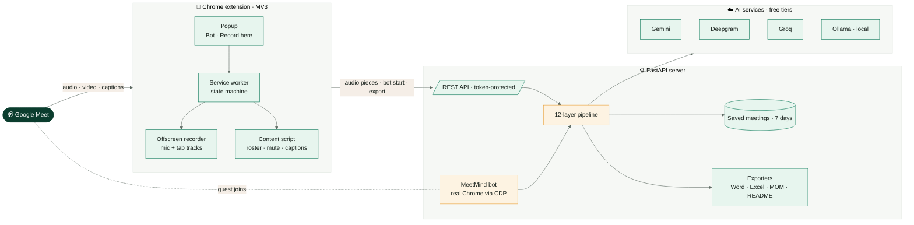
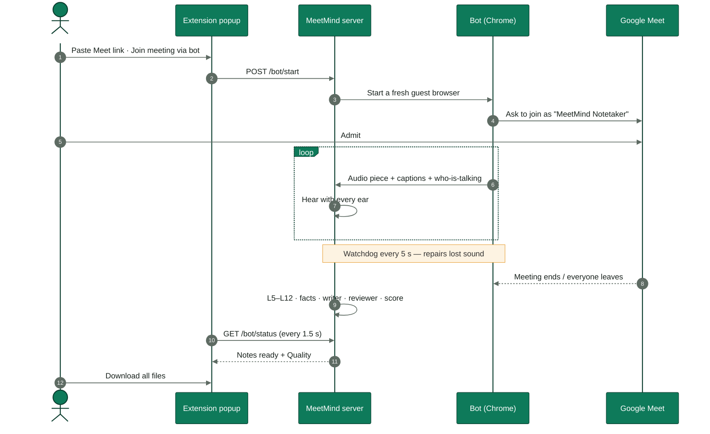

<div align="center">



<br/>

<p>
  
  
  
  
  
  
  <a href="LICENSE"></a>
</p>

<h3>Turn any Google Meet call into finished, checked meeting notes —<br/>real speaker names, real owners, real dates. Nothing invented.</h3>

<p>
  <a href="#-quick-start"><b>Quick start</b></a> ·
  <a href="#-how-it-works"><b>How it works</b></a> ·
  <a href="#-architecture"><b>Architecture</b></a> ·
  <a href="#%EF%B8%8F-configuration"><b>Configuration</b></a> ·
  <a href="#-api-reference"><b>API</b></a> ·
  <a href="SETUP_GUIDE.md"><b>Full setup guide</b></a>
</p>

</div>

---

## ✦ Why MeetMind

Most meeting note-takers hear the call **once**, with **one** engine, and then let an AI write whatever it likes.
That is how you get `ERPNex`, `PARTICIPANT 1`, swapped speakers and tasks nobody agreed to.

MeetMind treats meeting notes like data that has to be **verified**:

<table>
<tr>
<td width="33%" valign="top">

### 🎧 Several ears
Gemini, Deepgram and Meet's own captions hear the **same audio** and **vote word by word**. Doubtful words get a second listen.

</td>
<td width="33%" valign="top">

### 🧾 Facts before notes
Every task, decision and owner must be backed by a **quote found in the transcript**. Unbacked items are dropped.

</td>
<td width="33%" valign="top">

### 📊 A quality score
Every meeting gets a **0–100 score** that tells you how much was heard, confirmed and verified — and what went wrong.

</td>
</tr>
</table>

---

## ✦ What you get

After **Stop and create notes**, one click downloads everything as `MeetMind_<date>_<slug>.zip`:

| | File | What's inside |
| :---: | --- | --- |
| 📝 | **`MOM.md`** | Minutes: attendees with talk time, summary, discussion by topic, decisions, action items, next steps, **Quality** |
| 📄 | **`Meeting_Report.docx`** | Styled Word report with tables, screenshots (video mode) and a Quality table |
| 📋 | **`Action_Tracker.xlsx`** | One row per task — owner, real due date, priority and status dropdowns, overdue dates in red |
| 💬 | **`Transcript.txt`** | Every line with the speaker's real name and the time |
| 📘 | **`README.md`** | Short overview with a `- [ ]` task checklist |
| 🖼️ | **`screenshots/*.jpg`** | Video mode: taken only when the shared screen actually changes |

---

## ✦ Two ways to record

<table>
<tr>
<th width="50%">🤖 &nbsp;MeetMind bot <sub>(most accurate)</sub></th>
<th width="50%">🔴 &nbsp;Record here</th>
</tr>
<tr>
<td valign="top">

Paste any Meet link → **Join meeting via bot**.<br/>
A guest called **"MeetMind Notetaker"** asks to join; someone clicks **Admit**.

- Ears: Gemini + Deepgram + **Meet captions**
- Names from captions, who-is-talking and voice groups
- A watchdog repairs the sound if it drops; captions fill gaps
- Leaves when the meeting ends or everyone else leaves

</td>
<td valign="top">

Open the Meet tab → **Start recording** (or <kbd>Alt</kbd>+<kbd>Shift</kbd>+<kbd>M</kbd>).<br/>
Records **your mic and the call as two separate tracks**.

- Ears: Gemini + Deepgram
- Your mic is always you — no guessing
- **Audio** or **Audio and video** (local video + smart screenshots)
- Video never leaves your computer

</td>
</tr>
</table>

Accepted links: `meet.google.com/abc-defg-hij`, `meet.google.com/meet/abc-defg-hij`, `?authuser=…`, `g.co/meet/…`, or just the code.

---

## ✦ How it works

<div align="center">

</div>

<br/>



<details>
<summary><b>🔍 What each layer does (click to expand)</b></summary>
<br/>

| # | Layer | Tool (free) | What it does |
| :-: | --- | --- | --- |
| L1 | Clean audio | PyAV | Mono, 16 kHz, steady loudness |
| L2 | Find speech | Silero VAD | Finds speech, skips silent pieces (no engine call, nothing invented) |
| L3 | Ear 1 | Gemini Transcribe | Best words and Hinglish; your glossary as custom vocabulary |
| L4 | Ear 2 | Deepgram Nova-3 | Exact word times, confidence per word, voice groups |
| L5 | Ear 3 | Meet captions (bot) | Second opinion with real names; fills gaps when the sound fails |
| L6 | Extra ears | faster-whisper, IndicConformer *(optional)* | Listen again only to doubtful parts |
| L7 | Word vote | — | Lines up every ear word by word; agreement + confidence + glossary decide |
| L8 | Glossary fixer | RapidFuzz + Jellyfish | `ERP next` → `ERPNext`; sound-alike fixes on doubtful words only |
| L9 | AI fixer | Gemini → Groq → Ollama | Chooses between the ears' versions of doubtful words; meaning changes are rejected |
| L10 | Speaker vote | — | Captions + who-is-talking + voice groups; crosstalk is marked **Unclear**, never a wrong name |
| L11 | Facts first | Gemini | Facts with quotes and times, each checked against the transcript |
| L12 | Second opinion | Groq + RapidFuzz + dateparser | Missing tasks added, unsupported ones removed, "next Friday" / "kal" → real dates |

</details>

### Accuracy rules that are never broken

> [!IMPORTANT]
> - Every task must **quote words found in the transcript**. Below the evidence threshold it is dropped as invented.
> - Owners are matched to **real participants** only. Ambiguous → `Unassigned`. Placeholders are never owners.
> - Due dates are real calendar dates. Dates before the meeting or absurdly far away are dropped.
> - When people talk over each other, the line says **Unclear** — MeetMind never guesses a name.

---

## ✦ Quality score

Shown in the popup, in `MOM.md` and in the Word report:

| Score | Meaning |
| --- | --- |
| 🟢 **Recorded** | Share of the meeting with usable sound or captions |
| 🟢 **Words** | Share of words confirmed by 2+ ears (or very high confidence) |
| 🟡 **Speakers** | Share of words named by captions or 2+ agreeing signals |
| 🟡 **Notes** | Share of tasks backed by a verified quote |
| ⭐ **Overall** | Weighted total (estimated) |

Below the scores MeetMind lists anything that went wrong or was skipped — for example
*"The call sound stopped for a while; the bot repaired it and captions filled the gap."*

---

## ✦ Architecture



### Bot meeting flow



---

## ✦ Tech stack

<table>
<tr><td><b>Server</b></td><td>Python 3.11+ · FastAPI · Pydantic · Playwright / patchright · PyAV · Silero VAD (ONNX) · RapidFuzz · Jellyfish · dateparser · python-docx · openpyxl</td></tr>
<tr><td><b>Extension</b></td><td>TypeScript (plain <code>tsc</code>, no bundler) · Chrome Manifest V3 · Offscreen documents · MediaRecorder · IndexedDB</td></tr>
<tr><td><b>Speech</b></td><td>Gemini Transcribe · Deepgram Nova-3 · Groq Whisper · <i>optional</i> faster-whisper, AI4Bharat IndicConformer</td></tr>
<tr><td><b>Notes AI</b></td><td>Writer: Gemini → Groq → Ollama &nbsp;·&nbsp; Reviewer: Groq → Ollama → Gemini (always a different model)</td></tr>
<tr><td><b>Hosting</b></td><td>Your own computer (full features) or Render free tier (without the bot)</td></tr>
</table>

---

## 🚀 Quick start

### 1 · Get the free API keys

| Key | Where | Used for |
| --- | --- | --- |
| **Gemini** | [aistudio.google.com/apikey](https://aistudio.google.com/apikey) | Ear 1 and writing the notes |
| **Deepgram** | [console.deepgram.com](https://console.deepgram.com) | Ear 2 (exact word timings) |
| **Groq** | [console.groq.com/keys](https://console.groq.com/keys) | Backup ear and the reviewer AI |

> [!TIP]
> All three are recommended. With fewer keys MeetMind still works, and the Quality section says which layer was skipped.

### 2 · Configure

Fill the **Quick Setup** block at the top of `backend/config.yaml`:

```yaml
server:
  app_token: "a-long-random-text"   # python -c "import secrets; print(secrets.token_urlsafe(32))"
gemini:
  api_key: "..."
deepgram:
  api_key: "..."
groq:
  api_key: "gsk_..."
```

Then put the **same** app token in `extension/config.js` → `appToken`.

> [!CAUTION]
> Never commit real keys. After filling them in, run once:
> ```bash
> git update-index --skip-worktree backend/config.yaml extension/config.js
> ```
> Environment variables also work and override the file: `GEMINI_API_KEY`, `DEEPGRAM_API_KEY`, `GROQ_API_KEY`, `APP_TOKEN`.

### 3 · Start the server

```powershell
cd backend
python -m venv .venv
.venv\Scripts\activate                 # macOS / Linux: source .venv/bin/activate
python -m pip install -r requirements.txt
python -m playwright install chromium
python run.py                          # python run.py check  → validate config only
```

The banner prints every layer, the masked keys and the app token, so you can see at a glance what is on.

### 4 · Load the extension

1. Open `chrome://extensions` and turn on **Developer mode**
2. **Load unpacked** → select the `extension` folder
3. Details should say **Version 5.0.0**; the setup page should show all green ticks

### 5 · Record your first meeting 🎉

Click the MeetMind icon → **MeetMind bot** (paste a link) or **Record here** → **Stop and create notes** → **Download all files**.

<details>
<summary><b>➕ Optional: local models (offline backup, extra Hindi ear)</b></summary>
<br/>

```powershell
python -m pip install -r requirements-extra.txt
```

- **faster-whisper** re-listens to doubtful English parts and is the offline backup
- **AI4Bharat IndicConformer** re-listens to doubtful Hindi parts (gated on Hugging Face — accept its terms and run `huggingface-cli login`)
- **Ollama** (`ollama pull llama3.1:8b`) is the last backup for the AI steps

They are used automatically when installed and only ever run on doubtful parts, so a normal laptop can handle them.

</details>

---

## ⚙️ Configuration

Everything lives in **two files** — no code changes for normal settings.

| File | Purpose |
| --- | --- |
| `backend/config.yaml` | Server: keys, accuracy layers, glossary, storage, bot |
| `extension/config.js` | Extension: server URL, app token, recording, screenshots, Meet selectors |

<details>
<summary><b>Key server settings</b></summary>
<br/>

| Setting | Default | What it does |
| --- | --- | --- |
| `pipeline.ears.*` | all on | Switch single ears on or off |
| `pipeline.doubt_below` | `0.72` | Words scored below this are double-checked |
| `pipeline.ai_fixer` | `true` | AI chooses between heard versions of doubtful words |
| `vocabulary.terms` | ERPNext, Frappe… | Words that must be spelled exactly |
| `vocabulary.learn` | `true` | Remember corrected terms for next meetings |
| `notes.review` | `true` | A second, different AI checks the notes |
| `notes.section_minutes` | `12` | Long meetings are read in sections |
| `storage.keep_days` | `7` | Saved meetings are deleted after this |
| `quality.show_in_files` | `true` | Quality section in MOM.md and Word |
| `ollama.enabled` | `auto` | Local AI backup when it is running |
| `bot.piece_seconds` | `120` | Audio is heard in 2-minute pieces during the call |
| `bot.headless` | `false` | Keep false; Meet refuses hidden browsers more often |

</details>

---

## 🔌 API reference

All endpoints except `/health` require the headers `X-MeetMind-Token` and `X-MeetMind-Client`.
CORS allows only `chrome-extension://` origins.

| Method | Endpoint | Purpose |
| :---: | --- | --- |
| `GET` | `/health` | Status and version |
| `GET` | `/auth/check` | Token check, engines ready, minutes left today |
| `POST` | `/transcribe` | Upload one audio piece (`mic` / `tab` / `mix` track) |
| `POST` | `/analyze` | Build the corrected transcript and validated report |
| `POST` | `/export?kind=zip\|docx\|xlsx\|mom\|readme\|transcript` | Download the files |
| `POST` | `/bot/start` · `/bot/stop` · `/bot/reset` | Control the meeting bot |
| `GET` | `/bot/status` · `/bot/files` | Live bot state · bot meeting files |

---

## 📁 Project structure

```text
MeetMind/
├── backend/                    FastAPI server (also runs the bot)
│   ├── config.yaml             ← the ONLY server file you edit
│   ├── run.py                  start / check the server
│   └── app/
│       ├── api/                endpoints, token checks
│       ├── pipeline/           the 12 accuracy layers (one small file each)
│       ├── bot/                meeting bot: join, record, watchdog, finalize
│       ├── services/           AI calls, notes, validator
│       └── exporters/          Word, Excel, MOM, README, transcript, zip
├── extension/                  built Chrome extension, ready to load
│   └── config.js               ← the ONLY extension file you edit
├── extension-source/           TypeScript source (npm run build → extension/)
├── docs/assets/                README artwork
├── render.yaml                 optional Render deploy (without the bot)
├── SETUP_GUIDE.md              full step-by-step guide
└── ENHANCEMENT_PLAN.md         what v5.0 changed and why
```

---

## 🧪 Testing

| Suite | Checks | Covers |
| --- | :---: | --- |
| Layer tests | **56** | Audio prep, VAD, word vote, glossary, AI fixer safety, speaker vote, facts, dates, scores, every engine failing in turn |
| Bot end-to-end | **25** | Real extension + real bot vs a mock Meet with WebRTC voices, waiting room and lagged captions |
| Hard scenarios | **10** | Sound lost halfway, stop mid-meeting, refused once then admitted, always refused |
| Record here end-to-end | **18** | Both tracks, both ears, glossary fix, facts + writer + reviewer, quality score |

> [!NOTE]
> Tests use mock Meet pages and fake AI servers. Live Google Meet and the real Gemini / Deepgram / Groq services
> are checked in daily use — look at the Quality section of your first meetings.

---

## 🛠️ Troubleshooting

<details>
<summary><b>Show common fixes</b></summary>
<br/>

| Problem | Fix |
| --- | --- |
| "App token does not match" or `/bot/status 404` | An old server is on port 8000. `netstat -ano \| findstr :8000` → `taskkill /F /PID <id>` → `python run.py` |
| `pip` is not recognized | Use `python -m pip install -r requirements.txt` |
| Bot: "You can't join this video call" | Open the link in a Chrome **Guest** window. If that is refused too, the meeting does not allow guests |
| Bot: "No call audio has reached the bot yet" | Check the bot's window is in the call and shows "Sharing this tab" |
| Lines show **Unclear** | People talked over each other — MeetMind marks it instead of guessing |
| A word is still misspelled | Add it to `vocabulary.terms` |
| Old popup after an update | `chrome://extensions` → Remove → Load unpacked again |

</details>

---

## 🔒 Privacy

- **Tell everyone before you record.** The bot's name says it is a notetaker.
- Captions the bot turns on are visible only in its own window.
- Video stays on your computer; only small screenshots go to the server.
- Meetings are saved locally for `storage.keep_days` days, then deleted (`storage.enabled: false` keeps nothing).
- Audio is sent to the AI services you configure. Free tiers may use data to improve their products — avoid confidential meetings on free tiers.

---

## 🗺️ Roadmap

- [ ] Chrome Web Store release
- [ ] Push action items to Redmine or ERPNext ToDo
- [ ] Edit tasks in the popup before export
- [ ] More languages beyond `auto / en / hi`

---

<div align="center">

**Built by [Rajesh](https://github.com/rajesh-gotur)** · Released under the [MIT License](LICENSE)

<sub>If MeetMind saved you from writing minutes, leave a ⭐ on the repo.</sub>

</div>
